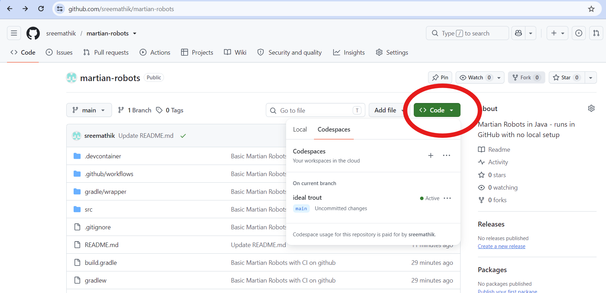

# Martian Robots


> **No local setup needed.** Click **Code -> Codespaces -> Create codespace** or check the **Actions** tab to see it build & run in GitHub.

## Technical Decisions
1. **Command Pattern**: `Command` interface + `CommandFactory` so new instructions (e.g. `J` for jump) can be added without touching `SimulationRunner`.
2. **ScentPositions as Set<Position>**: O(1) lookup, keyed by x,y only.
3. **Config**: All limits (`MAX_COORDINATE=50`, `MAX_INSTRUCTION_LENGTH=100`, `MIN_COORDINATE=0`) live in `Constants.java`. Configurable in one place.
4. **CI-first**: GitHub Actions runs build + tests + sample on every push, so reviewers don't need local Gradle/Java.
5. **Skipped**: Logging framework, DI, REST - not needed for stdin/stdout spec.


## Try it in 1 click - No install

### Option 1: GitHub Codespaces (Recommended for reviewers)
1. In the github repo, Next to branch name and add file section - Click **Code** (green button) -> **Codespaces** -> **Create codespace on main**

2. Wait 30s - Java 17 + Gradle 8.14.8 are pre-installed
3. In terminal:
```bash
./gradlew test
java -jar build/libs/martian-robots-1.0.jar < input.txt
```
If gradlew fails with 'Permission denied' try below :
```bash
chmod +x gradlew
./gradlew clean build
./gradlew test
java -jar build/libs/martian-robots-1.0.jar < input.txt
```
Expected:
```
1 1 E
3 3 N LOST
2 3 S
```
4. You can keep modifying input.txt and run 'java -jar build/libs/martian-robots-1.0.jar < input.txt' to try different output

### Option 2: GitHub Actions (See it run automatically)
1. Go to **Actions** tab -> Latest **CI** run
2. Expand **Run sample input** - you will see the output above, no clone needed.
3. Download the built JAR from **Artifacts** -> `martian-robots-jar`

### Option 3: Local (if you have Java 17)
```bash
./gradlew build
./gradlew test
java -jar build/libs/martian-robots-1.0.jar < input.txt
```
Windows PowerShell: use `.\gradlew.bat` instead of `./gradlew`


## Project structure
```
src/main/java/com/martianrobots/
  App.java, Grid.java, Robot.java, Position.java, Direction.java
  Constants.java, SimulationRunner.java
  command/ Command.java, MoveForward.java, TurnLeft.java, TurnRight.java, CommandFactory.java
```

## Sample
Input in `input.txt` produces:
```
1 1 E
3 3 N LOST
2 3 S
```
